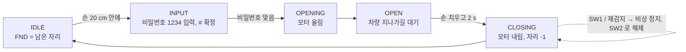

# 주 2 : ① 순차 루프 구조 (인터럽트 없음)

## 1. 결선표

주 1 의 29가닥 그대로 (소표는 `주1_부품테스트/결선표_및_테스트순서.md`).

| 기능 | EVB 핀 |
|---|---|
| FND 세그먼트 A ~ G | PTD1 ~ PTD7 |
| FND 자릿수 CM1 ~ CM4 | PTD8 ~ PTD11 |
| 키패드 ROW1 ~ 4 | PTE0, PTE1, PTE2, PTE3 |
| 키패드 COL1 ~ 3 | PTE12, PTE14, PTE15 |
| 스텝모터 IN1 ~ IN4 | PTB8, PTB9, PTB10, PTB11 |
| 초음파 TRIG | PTC16 |
| 초음파 ECHO | PTC17 |
| 비상 버튼 SW1 | PTC8 |
| 해제 버튼 SW2 | PTC9 |
| 부저 | PTD12 |
| 차량 감지 LED0 | PTE8 |
| 경고 LED1 | PTE9 |

| 추가 | 결선 | 언제 |
|---|---|---|
| 측정 점퍼 1가닥 | PTC8 에서 SW1 선(J13-1)을 빼고 그 자리에 PTE16 점퍼를 꽂음 | main.c `MEASURE 1` (측정 중 SW1 은 안 씀) |
| OLED 2가닥 | J34 SCL → PTA3, SDA → PTA2 | main.c `USE_OLED 1` (+ oled.c/.h) |

## 2. 코드 파일

S32DS 프로젝트 = `main.c` + `tp_board.c/.h` + `clocks_and_modes.c/.h`. `tp_board`, `oled` 는 주 1 과 같은 파일.

| main.c 스위치 | 0 | 1 |
|---|---|---|
| `USE_OLED` | OLED 안 씀 | 상태 · 거리 · 자리 수 표시 |
| `MEASURE` | 시스템 동작 | 스트레스 측정 100 회 → PuTTY 에 결과표 |

## 3. 동작 (비밀번호 1234)

모든 상태 변화는 UART 9600 으로 `[상태] 메시지` 로 나간다. 비밀번호 `REG_PIN 1234`, 자리 `SLOTS_INIT 12`, 감지 `DETECT_CM 20`, 통과 판정 `PASS_CLEAR_MS 2000` 은 main.c 맨 위 define.

## 4. 측정 (`MEASURE 1`)

1. `MEASURE 1` 로 빌드. PTC8 의 SW1 선을 빼고 PTE16 점퍼를 꽂는다. PuTTY.
2. 리셋 → 128 스텝 열림 · 닫힘 100 회 자동 반복 (약 3 분). 닫히는 중 코드가 PTE16 을 내려 비상 버튼을 누르고 UART 20 글자를 내보낸다.
3. 끝나면 PuTTY 에 R1 ~ R5, FND 에 R1 평균(ms).

| 항목 | 재는 것 |
|---|---|
| R1 | 비상 핀 하강 → 모터 정지 (us). 평균 · 최대 · 최소 · 표준편차 |
| R2 | R1 최대 − 최소 |
| R3 | 모터 스텝 간격 최대 · 최소 (목표 2000 us) |
| R4 | 루프 1바퀴 최대 · 최소 (Seg_out 4 ms 제외 시간은 FND 꺼짐) |
| R5 | 초음파 측정 횟수 / 10 s (목표 100) |

정상이면 사이클마다 `[EMERGENCY] EMERGENCY STOP : SW1` 이 찍힌다. 안 찍히면 점퍼가 PTC8 에 안 들어간 것. 끝나면 SW1 선을 PTC8 에 다시 꽂는다.

## 5. 산출물

- [x] 11-26 시스템 동작 확인 (감지 → 번호 → 열림 → 통과 → 닫힘, 비상 정지 · 해제)
- [ ] 동작 영상
- [ ] `MEASURE 1` 결과 (PuTTY 캡처) → 계획서 5절 표 ① 열
